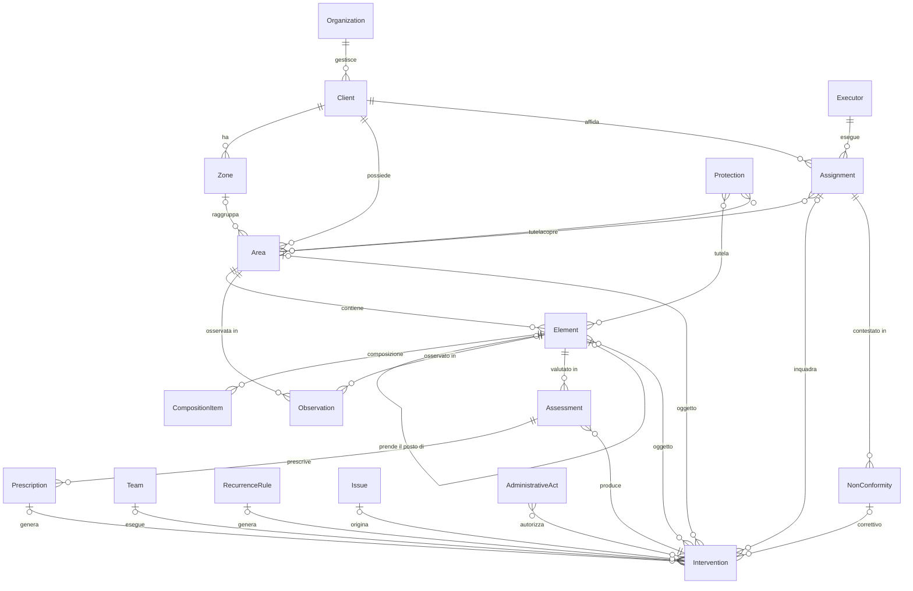
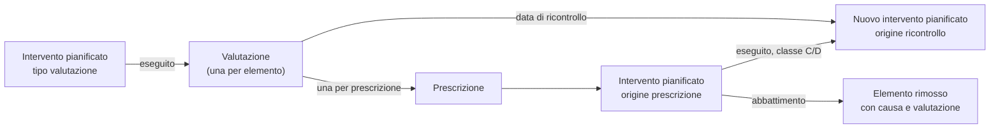
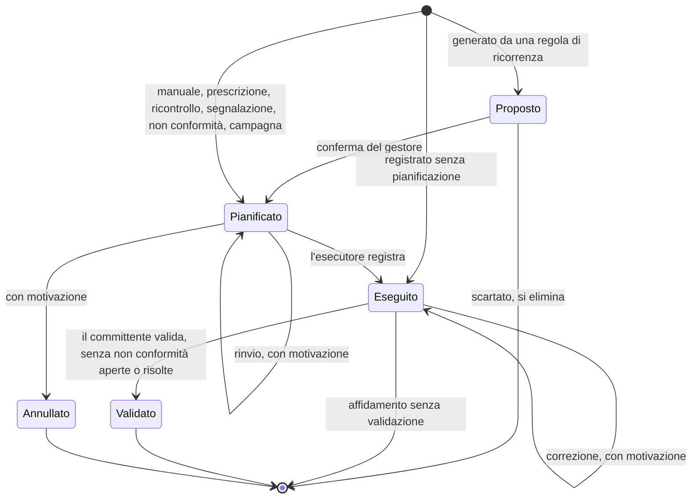
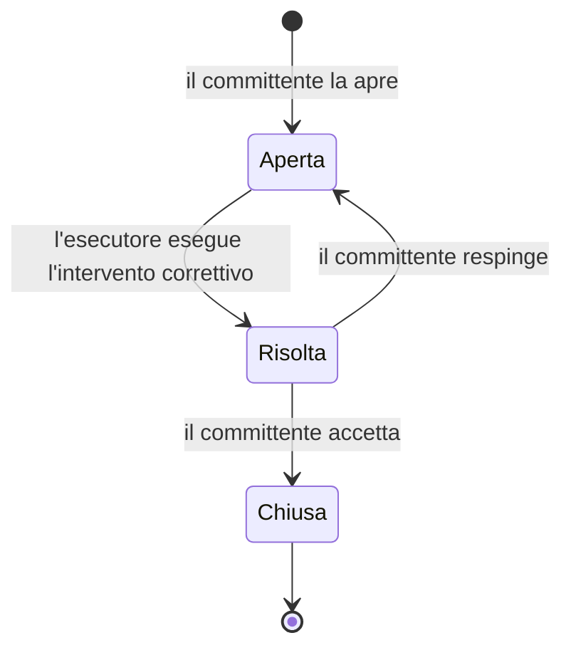

# GreenManager — Specifica del dominio applicativo

> **Stato**: scritto, in attesa della revisione · **Passo**: 5 di 5 · Metodologia in [README.md](README.md)

- **Obiettivo**: descrivere GreenManager in un solo documento, per chi lo legge dall'esterno: committenti, partner, persone che entrano nel progetto, revisori.
- **Input**: i documenti degli Step 1–4, le decisioni D-001–D-058, il glossario.
- **Uso**: il documento si legge da solo. I documenti dei passi precedenti sono le sue appendici: danno il dettaglio e le motivazioni di ogni scelta.

| Appendice | Documento | Contenuto |
|---|---|---|
| A | [01-analisi-spec-esistente.md](01-analisi-spec-esistente.md) | La specifica di partenza, un software Access 97 per il censimento del verde pubblico, e le sue lacune |
| B | [02-benchmark.md](02-benchmark.md) | Prodotti simili, contesto normativo italiano, matrice delle feature |
| C | [03-features.md](03-features.md) | Attori, posizionamento, catalogo delle 102 feature, scenari |
| D | [04-modello-dati.md](04-modello-dati.md) | Schede delle entità e dei cataloghi, scelte di modellazione, note per Django |
| — | [decisioni.md](decisioni.md) | Registro delle decisioni, con le alternative scartate |
| — | [glossario.md](glossario.md) | Termini del dominio e nomi delle entità |
| — | [architettura/](architettura/README.md) | Binario tecnico: stack, struttura del codice, prima fetta verticale |

**Convenzioni.**
- Le feature si citano con l'identificativo del catalogo (EL-3, IN-6…), le decisioni con il numero (D-012).
- Priorità:
  - **MVP**: la prima versione da mettere in uso;
  - **v2**: la versione successiva;
  - **futuro**: nel perimetro, senza una versione prevista.
- Le entità hanno il nome in inglese, quello del codice, accanto al termine italiano (D-001).
- Le scelte segnate *ipotesi* vengono dalla prima fetta verticale e si confermano alla sua revisione (§10).

## 1. Il prodotto

### 1.1 Cosa fa

GreenManager è un'applicazione web per il censimento e la gestione del verde su un territorio. Si rivolge a:
- ditte di manutenzione del verde;
- enti pubblici: comuni, consorzi, parchi;
- privati con superfici verdi estese: complessi residenziali, aziende, ville storiche.

Si regge su tre pilastri:

| Pilastro | Risponde a | Cosa registra |
|---|---|---|
| Censimento | Cosa c'è, e dove? | Aree ed elementi georeferenziati: alberi, siepi, prati, aiuole, arredi, giochi |
| Registro delle azioni | Cosa si è fatto, e cosa si farà? | Interventi pianificati, eseguiti e validati |
| Registro dello stato | Come sta? | Osservazioni datate, misure, foto, valutazioni di stabilità |

Si usa in ufficio e in campo, da smartphone e tablet, con il GPS e la fotocamera del dispositivo (D-014). Una mappa pubblica in sola lettura mostra ai cittadini i dati che il committente sceglie di pubblicare (D-015).

### 1.2 Posizionamento

GreenManager copre due cose (D-012):
- **la gestione tecnica del verde**: censimento, stato, interventi;
- **il rapporto tra committente ed esecutore**, quando appartengono a organizzazioni diverse. L'esecutore registra l'eseguito e aggiorna il censimento; il committente valida l'eseguito o lo contesta con una non conformità.

Prezzario, computo e SAL sono nel perimetro, ma dopo l'MVP. Già nell'MVP l'intervento eseguito registra le quantità, che servono al rapporto annuale dei CAM e sono la base del prezzario.

Resta fuori la **gestione d'impresa** della ditta: CRM, preventivi, budget, fatturazione, magazzino. Della gestione d'impresa resta il nucleo tecnico: l'anagrafica del committente, il piano di manutenzione e le quantità eseguite. L'export degli interventi eseguiti fa da ponte verso il gestionale della ditta.

Le ragioni:
- **un solo modello** serve le quattro configurazioni organizzative di §2.2;
- **ditte ed enti lavorano sugli stessi dati**, invece di usare due prodotti e scambiarsi file;
- **risponde ai CAM**, che chiedono alla ditta di aggiornare il censimento dell'ente e di consegnare un rapporto annuale;
- tra i prodotti analizzati, solo GreenSpaces gestisce il rapporto tra ente e ditta (§4.2 di [02-benchmark.md](02-benchmark.md)).

### 1.3 Contesto normativo

Il dominio è regolato da leggi, criteri per gli appalti pubblici e standard tecnici. Il dettaglio è in §2 di [02-benchmark.md](02-benchmark.md), con i requisiti N1–N20.

| Fonte | Cosa chiede | Come risponde GreenManager |
|---|---|---|
| L. 10/2013 e L. 113/1992 | Ai comuni: catasto degli alberi pubblici, bilancio arboreo di fine mandato, un albero per ogni nuovo nato | Catasto come livello 2 dei CAM (EL-2), bilancio arboreo (RE-9), alberi dedicati (EL-14, v2) |
| L. 10/2013, art. 7; D.Lgs. 42/2004; circolare 461/2020 | Tutela degli alberi monumentali e del verde storico; interventi comunicati o autorizzati | Vincoli (EL-12) ed estremi degli atti (IN-13); in v2 gli atti richiesti per tipo di vincolo e di intervento (IN-14) |
| CAM Verde pubblico (DM 63/2020) e modello dati del censimento v2.1 | Censimento a tre livelli, piano di manutenzione, aggiornamento del censimento da parte della ditta, rapporto annuale, formato di consegna | Anagrafica delle aree (AR-1), regole di ricorrenza (IN-3), aggiornamento dall'esecutore (CE-4), riepilogo annuale (RE-10), import ed export CAM (RE-7) |
| ISTAT, rilevazione "Dati ambientali nelle città" | Superfici per tipologia di verde, alberi, abbattimenti per causa | Tipologia ISTAT delle aree (D-009), causa della rimozione ricondotta alle cause ISTAT (IN-11), dati per l'ISTAT (RE-11, v2) |
| Codice civile, artt. 2043 e 2051 | Il custode risponde dei danni causati dagli alberi | Storico non modificabile di valutazioni e interventi (TR-6) |
| SIA (2008, 2015); linea guida per la foresta urbana pubblica (2025); linee guida CONAF sul rischio (2026) | Valutazione della stabilità o del rischio, ricontrolli programmati, censimento separato dalla valutazione | Protocolli a catalogo (D-010), ricontrolli e prescrizioni (ST-6–ST-8); rischio CONAF in v2 (ST-11) |
| UNI EN 1176-7 | Ispezioni periodiche delle attrezzature gioco | Giochi censiti nell'MVP, ispezioni in v2 (D-017) |
| D.Lgs. 150/2012 e PAN | Trattamenti fitosanitari con operatori abilitati e avviso alla popolazione | Trattamenti e abilitazioni in v2 (IN-15, AF-5) |
| Reg. (UE) 2024/1991, art. 8 | Nessuna perdita netta di verde urbano e di copertura arborea al 2030 | Copertura arborea dai diametri delle chiome (RE-12, v2) |

È una lettura tecnica, non un parere legale. I punti da verificare prima del rilascio sono in §9.

### 1.4 Perimetro

**Dentro la specifica**: entità del dominio, cataloghi, flussi operativi, regole di business, report ed export, modello dati.

**Vincoli nominati, non specificati nel dominio**: autenticazione, multi-tenancy, ruoli e permessi, infrastruttura, deploy, design dell'interfaccia. I primi tre hanno un'implementazione di riferimento nel binario tecnico ([architettura/](architettura/README.md)). I vincoli che il dominio pone alla multi-tenancy sono in §8.3.

**Fuori dal prodotto** (§3.12 di [03-features.md](03-features.md)):
- preventivi, budget e costi a consuntivo; CRM, canoni, pacchetti di ore, rinnovi dei contratti, proposte commerciali; fatturazione, magazzino, contabilità; materiali diversi dalle piante e dai prodotti fitosanitari;
- flotta e posizione dei mezzi; gestione degli impianti di irrigazione e illuminazione, i cui componenti si censiscono come arredi;
- alberi privati che interferiscono con strade e reti; censimento partecipativo dei cittadini; censimento da scansioni e immagini, che entra con l'import;
- procedimento autorizzativo (istanze, pareri, termini): si registrano solo gli estremi dell'atto (D-024);
- firma digitale delle relazioni: la relazione firmata è un allegato (D-022);
- import dedicato dei database Access: un censimento esistente entra con l'import generico o CAM (D-026).

## 2. Attori e configurazioni

### 2.1 Attori

Gli attori sono i ruoli della gestione del verde, con o senza GreenManager. Un soggetto può averne più di uno: un comune che lavora con le proprie squadre è committente, gestore ed esecutore.

| Attore | Chi è | Nel sistema |
|---|---|---|
| A1 Committente | Il titolare del verde, o chi lo ha in carico: comune, consorzio, ente parco, condominio, azienda, privato. È custode degli alberi (art. 2051 c.c.). | Consulta patrimonio, interventi e report; valida l'eseguito e apre le non conformità |
| A2 Gestore | Chi decide sul patrimonio per conto del committente: l'ufficio verde, il responsabile tecnico della ditta, l'agronomo di una villa | È l'utente principale: aree, censimento, piani, interventi, valutazioni, report |
| A3 Rilevatore | Chi censisce in campo | Censimento e osservazioni, da smartphone o tablet |
| A4 Valutatore | Il professionista abilitato che valuta la stabilità o il rischio degli alberi | Inserisce le valutazioni con la scheda del gestore, anche da un'altra organizzazione; oppure il gestore registra i dati minimi e allega la sua relazione (D-022) |
| A5 Esecutore | Chi esegue gli interventi: squadre interne, ditta, associazione, impresa che ha adottato un'area | Interventi assegnati, registrazione dell'eseguito, segnalazioni, anche da un'altra organizzazione |
| A6 Autorità | Comune e ministero per gli alberi monumentali, Soprintendenza, Servizio fitosanitario, ISTAT | Non usa il sistema: riceve documenti ed export |
| A7 Cittadino | Chi frequenta il verde; la famiglia di un nuovo nato; chi dona un albero | Consulta la mappa pubblica; in v2 invia segnalazioni |

- **Gestore e valutatore restano distinti** anche quando sono la stessa persona: la linea guida del 2025 separa chi valuta l'albero da chi decide il rischio accettabile e gli interventi.
- **Rilevatore, valutatore ed esecutore lavorano in campo**, da smartphone o tablet.
- **I cataloghi** li cura chi gestisce il sistema, per le voci di sistema, e ogni organizzazione, per le proprie voci (§3.9).

### 2.2 Configurazioni organizzative

Gli stessi ruoli si distribuiscono in modo diverso secondo chi possiede il verde e chi lo cura. Il modello le rappresenta tutte con tre concetti (§3.3): il **committente**, la sua **organizzazione di gestione** e l'**esecutore** di un affidamento.

| Configurazione | Committente | Organizzazione di gestione | Esecutore | Validazione dell'eseguito |
|---|---|---|---|---|
| K1. Ente in economia | Comune o altro ente | L'ente | Squadre dell'ente | No: l'eseguito è lo stato finale |
| K2. Ente con appalto | Comune o altro ente | L'ente, con il direttore dell'esecuzione del contratto | Ditta appaltatrice | Sì |
| Variante di K2 | Comune | Azienda pubblica che gestisce il verde per il comune | Ditta | Sì, da parte dell'azienda pubblica |
| K3. Ditta per più clienti | Condominio, azienda, ente | La ditta | Squadre della ditta | Se l'affidamento la prevede |
| K4. Privato con verde esteso | Villa storica, complesso residenziale, azienda | Il proprietario o il suo curatore | Giardinieri interni o ditta | Se l'affidamento la prevede |

- In K1 e K4 una sola organizzazione copre quasi tutti i ruoli.
- In K2 due organizzazioni lavorano sullo stesso patrimonio: l'ente decide e controlla, la ditta esegue e aggiorna il censimento.
- In K3 la ditta gestisce ed esegue per molti committenti.
- K2 e K3 si sovrappongono: per la ditta, un ente con appalto è uno dei suoi clienti.

## 3. Il modello del dominio

Le schede complete delle entità, con tutti i campi, sono in §2 e §3 di [04-modello-dati.md](04-modello-dati.md).

### 3.1 Principi

1. **Il committente è la radice del patrimonio.** Zone, aree, elementi, interventi e affidamenti appartengono a un committente, gestito da un'organizzazione (D-032).
2. **L'elemento è l'unità di censimento** (D-002). Ha sempre una geometria e un'area. Un elemento lineare o areale può rappresentare un gruppo, con la sua composizione di specie (D-018).
3. **Anagrafica e registri sono separati.** L'anagrafica (aree, elementi, affidamenti) descrive cosa c'è: si modifica, e ogni modifica resta nello storico. I registri (osservazioni, valutazioni, interventi eseguiti) descrivono cosa è successo: si aggiungono e non si cancellano.
4. **Lo stato è un'osservazione datata** (D-007). Lo stato corrente di un elemento viene dalle sue ultime osservazioni valide; l'elemento ne tiene una copia per mappe, filtri ed export.
5. **Cataloghi in tabella, comportamenti nel codice.** Le liste che gli utenti estendono sono cataloghi; le liste da cui dipende la logica sono enumerazioni (D-027).
6. **Tutto è tracciato.** Identificativi UUID, autore e organizzazione di ogni modifica, storico delle modifiche, revisione di ogni record (D-014, D-034).
7. **I derivati si calcolano.** Superfici, lunghezze, scadenze e conteggi vengono da geometrie e date.

### 3.2 Le entità principali

| Gruppo | Entità |
|---|---|
| Soggetti e affidamenti | Committente (`Client`), Esecutore (`Executor`), Persona (`Person`), Squadra (`Team`), Affidamento (`Assignment`); Abilitazione (`Qualification`, v2) |
| Territorio | Zona (`Zone`), Area (`Area`), Vincolo (`Protection`); Bersaglio (`RiskTarget`, v2) |
| Elementi | Elemento (`Element`), Voce della composizione (`CompositionItem`); Dedica (`Dedication`, v2) |
| Stato e valutazioni | Osservazione (`Observation`), Valutazione (`Assessment`), Prescrizione (`Prescription`); Campagna di controllo (`InspectionCampaign`, v2) |
| Interventi | Intervento (`Intervention`), Quantità (`InterventionQuantity`), Regola di ricorrenza (`RecurrenceRule`), Atto (`AdministrativeAct`), Segnalazione (`Issue`); Livello di manutenzione, Ordine di lavoro, Trattamento fitosanitario (v2) |
| Rapporto tra committente ed esecutore | Non conformità (`NonConformity`) e i suoi passaggi di stato; Prezzario (v2); SAL (futuro) |
| Trasversali | Allegato (`Attachment`), Storico delle modifiche (`ChangeRecord`), Import (`ImportBatch`), Impostazioni della mappa pubblica (`PublicMapSettings`) |
| Cataloghi | Specie, classi di elemento, attributi, tipi di intervento, condizioni, protocolli di valutazione, codici CAM e cataloghi minori (§3.9) |
| Di confine | Organizzazione (`Organization`) e utente (`User`), definiti dalla multi-tenancy e dall'autenticazione |

### 3.3 Committente, esecutore e affidamento

- **Organizzazione** (`Organization`): il soggetto che usa il sistema, cioè una ditta, un ente o un gestore privato. Gli utenti ne fanno parte con ruoli propri.
- **Committente** (`Client`): il titolare del patrimonio, distinto dall'organizzazione che usa il sistema, perché una ditta lavora per più committenti (D-013). Ha un'**organizzazione di gestione**: quella del gestore, che organizza il patrimonio e affida i lavori (D-032). Il proprietario non è un'entità: nella variante di K2 il committente è il comune e l'organizzazione di gestione è l'azienda pubblica.
- **Esecutore** (`Executor`): un'anagrafica tenuta dall'organizzazione di gestione. Può essere un'impresa, una cooperativa, un'associazione, un professionista o le squadre interne. Se usa il sistema è collegato alla propria organizzazione.
- **Squadra** (`Team`): appartiene all'organizzazione dell'esecutore, che la usa per tutti i suoi committenti.
- **Persona** (`Person`): operatori, rilevatori e valutatori sono persone del dominio, distinte dagli utenti (D-031). Un rilevatore citato in un file importato, o un agronomo che consegna solo la relazione, non hanno un account.
- **Affidamento** (`Assignment`): lega un committente a un esecutore, con:
  - una modalità: in economia, in appalto, in adozione, in sponsorizzazione;
  - le aree coperte, o tutte le aree del committente;
  - un periodo e, se serve, i tipi di intervento coperti;
  - gli estremi del contratto;
  - due indicazioni: se l'eseguito va validato, e se l'esecutore aggiorna il censimento.

Regole:
- il patrimonio di ogni committente è separato da quello degli altri: ogni dato operativo appartiene a un solo committente;
- l'esecutore di un affidamento è nell'anagrafica dell'organizzazione di gestione del committente;
- sulla stessa area possono valere più affidamenti, per tipi di intervento diversi o in periodi successivi. Un affidamento usato da interventi non si cancella;
- un intervento rientra in un affidamento se la sua area, il suo tipo e la sua data sono coperti;
- l'incarico a un valutatore è un affidamento per il tipo di intervento "valutazione" (D-025);
- in K1 ogni committente ha un affidamento in economia alle proprie squadre, senza validazione;
- un committente disattivato resta consultabile e modificabile, ma non riceve zone, aree ed elementi nuovi (D-055, *ipotesi*).

### 3.4 Territorio: zone, aree e vincoli

- **Zona** (`Zone`): raggruppamento facoltativo di aree (quartiere, circoscrizione, complesso di un cliente), con un codice numerico univoco per committente. È l'unico livello sopra l'area (D-019) e corrisponde alla zona del modello dati CAM.
- **Area** (`Area`): la porzione di territorio gestita, corrispondente all'area di gestione del CAM.
  - Codice: numero e subalterno, univoco per committente.
  - Perimetro: un poligono, anche con più parti e con buchi (D-035). Si disegna sulla mappa o si importa; superficie e perimetro si calcolano (AR-2).
  - Tre classificazioni obbligatorie (D-009): tipologia di verde urbano dell'ISTAT, da un catalogo fisso; destinazione d'uso; intensità di fruizione.
  - Date di inizio e fine della gestione; comune in cui si trova (codice ISTAT); livello di censimento raggiunto (1 aree, 2 alberi, 3 tutti gli elementi); rilevatore e data del rilievo.
  - Un'**area fittizia**, come un viale di cui si gestiscono solo gli alberi, è esclusa dal calcolo delle superfici (AR-3).
- **Vincolo** (`Protection`): una tutela che limita gli interventi. Ha un tipo (albero monumentale, bene culturale o paesaggistico, area di quarantena), il riferimento all'elenco o all'atto e gli oggetti tutelati: elementi, aree e, in v2, una zona disegnata sulla mappa.

Regole:
- **sovrapposizioni** (AR-5): le aree dello stesso committente non si sovrappongono, perché le superfici si sommano. Il sistema avvisa e non blocca: dati importati e rilievi in campo possono essere imprecisi, e le aree sovrapposte restano in un elenco da sistemare. Nella fetta due aree si sovrappongono se le parti interne si intersecano e i periodi di gestione si sovrappongono: due aree che si toccano non si sovrappongono, e le aree fittizie non contano (D-050, *ipotesi*);
- **più parti**: un parco diviso da una strada può essere una sola area multiparte. Le parti con gestione o classificazione diverse restano aree distinte della stessa zona;
- **fine della gestione**: un'area chiusa resta nello storico, e i suoi elementi vanno rimossi o spostati;
- **storico**: i cambi di perimetro e di classificazione restano nello storico delle modifiche, da cui si ricostruiscono le superfici a una data;
- **vincoli**: un elemento è vincolato se è tutelato direttamente, se lo è la sua area o, in v2, se sta nella zona di un vincolo. È un dato calcolato, che serve agli avvisi sugli interventi (§3.7) e al campo "protezione" del catasto degli alberi.

### 3.5 Elementi

- **Elemento** (`Element`): l'oggetto censito, con la sua geometria (D-002): albero, arbusto, siepe, filare, prato, aiuola, bosco, arredo, gioco.
- **Classe di elemento** (`ElementClass`), da catalogo (D-006). Decide:
  - il tipo di geometria: punto, linea o poligono. Linee e poligoni possono avere più parti; i punti no (D-035);
  - l'unità con cui la classe si conta nei riepiloghi;
  - se l'elemento ha una specie, una composizione o nessuna delle due;
  - se l'elemento conta come albero nel catasto e nel bilancio arboreo;
  - gli attributi da rilevare, come il tipo di prato o il materiale di una panchina (EL-3);
  - il codice predefinito del modello dati CAM.
- **Specie** (`Species`): un catalogo botanico separato dalla classe (D-006), che comprende generi, specie, ibridi e cultivar.
- **Elemento di gruppo**: una siepe mista, un'aiuola, una macchia arbustiva o un bosco hanno una **composizione**, cioè un elenco di specie con la quantità o la percentuale di ciascuna, e un eventuale numero stimato di individui (D-018). Gli alberi del catasto si censiscono uno per uno.
- **Codice e cartellino** (EL-8): il codice leggibile è univoco per committente e non si riusa mai. Il numero di cartellino è quello della targhetta. Nella fetta (D-051, *ipotesi*) il codice lo dà il sistema, con un contatore del committente, e il cartellino è univoco tra gli elementi presenti: quello di un elemento rimosso si può riusare.
- **Posizione**: ha uno stato (verificata o provvisoria), un'origine (GPS, mappa, import, centro dell'area) e la precisione dichiarata dal dispositivo. Un elemento importato senza coordinate precise entra in una **posizione provvisoria**, per esempio al centro della sua area, e resta segnalato finché un rilevatore non lo posiziona in campo (EL-10, D-026).
- **Ciclo di vita** (EL-7): l'elemento ha la data di posa o di messa a dimora e, quando viene rimosso, la data e la causa della rimozione. Un elemento è **presente** alla data D se è stato posato entro D e non è stato rimosso entro D.
- **Sostituzione** (D-029): un elemento può indicare l'elemento rimosso di cui prende il posto. La catena delle sostituzioni è lo storico di una posizione: ippocastano → posto libero → tiglio. Il posto d'impianto non è un'entità: posti liberi e ceppaie (v2) sono elementi di classi dedicate, che non contano come alberi.

Regole:
- **area**: ogni elemento ha un'area. Il sistema propone quella che contiene la posizione, e il rilevatore la può cambiare. Un elemento fuori dalla propria area resta segnalato (AR-5);
- **doppioni**: il sistema avvisa se un albero nuovo è molto vicino a un albero presente dello stesso committente. Nella fetta la soglia è 2 m, e contano solo le posizioni verificate (D-052, *ipotesi*);
- **specie**: obbligatoria per le classi con specie singola, salvo gli elementi importati con una specie da associare, che restano in un elenco da completare. La composizione vale solo per le classi che la prevedono; le percentuali delle specie presenti non superano 100;
- **misure**: diametri, altezza, chioma e misure della classe non sono attributi dell'elemento ma valori delle osservazioni (§3.6). Gli attributi che non cambiano nel tempo, come la specie o il materiale, restano sull'elemento: un loro cambio è una correzione;
- **rimozione**: un elemento rimosso resta nello storico e non riceve più interventi pianificati, osservazioni o valutazioni. Per le classi che contano come alberi la causa è obbligatoria. Nella fetta la data di rimozione non è futura: una rimozione ancora da fare è un intervento da pianificare (D-051, *ipotesi*);
- **cancellazione**: si cancella solo un elemento inserito per errore, senza registri collegati;
- **filari**: un filare i cui alberi sono censiti uno per uno è rappresentato dai suoi alberi. Interventi e vincoli sull'intero filare hanno come oggetto quegli alberi.

### 3.6 Stato: osservazioni e valutazioni

- **Osservazione** (`Observation`): il rilievo datato dello stato di un elemento o di un'area (D-007, D-021). Contiene:
  - la condizione, da un catalogo con una scala ordinata;
  - per gli elementi, le misure (D-028): diametro a 1,30 m, uno per fusto, altezza, diametro della chioma, fase di sviluppo e le misure previste dalla classe, come l'altezza di una siepe. Un'osservazione con misure è un **rilievo**;
  - note, foto, autore e origine (campo, ufficio, import).
- **Valutazione** (`Assessment`): la valutazione di stabilità o di rischio di un albero secondo un protocollo (D-010); in v2 anche l'ispezione di un gioco (D-017). Contiene il protocollo, il tipo di valutazione, il valutatore, la data, la classe o l'esito, il giudizio sintetico, la data del ricontrollo, le prescrizioni e gli allegati (relazione firmata, referti, foto).
- **Prescrizione** (`Prescription`): un intervento indicato dal valutatore, con un termine e una priorità (ordinaria, urgente, indifferibile).

Regole:
- **registri**: osservazioni e valutazioni non si cancellano. Si correggono, con la motivazione nello storico, o si annullano. Lo stato corrente ignora i record annullati;
- **censimento e valutazione restano separati**: il censimento non contiene giudizi sul rischio, che stanno nella valutazione (linea guida 2025);
- **la valutazione nasce da un intervento** di tipo valutazione. Una valutazione registrata senza pianificazione crea l'intervento eseguito, così ogni valutazione ha un esecutore e un affidamento (D-025);
- **due modi di inserirla** (D-022), con lo stesso contenuto minimo: il valutatore usa la scheda del gestore, anche se lavora per un'altra organizzazione; oppure il gestore registra i dati minimi e allega la relazione, che in questo caso è obbligatoria;
- **ricontrollo** (ST-6): la data non supera il massimo della classe del protocollo (SIA: A 60 mesi, B 36, C 24) e, se manca, vale il massimo. Il ricontrollo è un intervento pianificato di tipo valutazione, con origine *ricontrollo*. Se una valutazione arriva prima, chiude il ricontrollo pianificato;
- **prescrizioni** (ST-7): ognuna genera un intervento pianificato con la sua scadenza. Con le classi che lo prevedono (C/D), l'esecuzione dell'intervento prescritto pianifica una nuova valutazione (ST-8);
- **esiti critici** (ST-9): una valutazione è critica se la classe lo è o se c'è una prescrizione urgente o indifferibile. Resta in evidenza finché il gestore non ne prende visione; le prescrizioni urgenti restano in evidenza finché non sono eseguite;
- **il gestore non modifica la valutazione**: decide sulle prescrizioni. Ne può cambiare termine o tipo di intervento sull'intervento che ne deriva, con una motivazione, o annullare quell'intervento.

### 3.7 Interventi

- **Intervento** (`Intervention`): un'azione su un oggetto, cioè un'area oppure uno o più elementi dello stesso committente. Ha:
  - un tipo, da catalogo;
  - la data o la finestra prevista, la scadenza e la priorità;
  - l'affidamento e la squadra;
  - l'origine;
  - le quantità stimate ed eseguite.
- **Tipo di intervento** (`InterventionType`): dice a quali classi si applica, l'unità della quantità, come stimarla dalla geometria e l'**effetto sul censimento**: nessuno, rimozione, messa a dimora, sostituzione, valutazione. Così un'organizzazione aggiunge tipi propri senza cambiare la logica.
- **Origine**: manuale, ricorrenza, prescrizione, ricontrollo, segnalazione, non conformità (intervento correttivo) e, in v2, campagna di controllo.

**Piano e regole di ricorrenza** (D-020, D-033).
- Una **regola di ricorrenza** ha un tipo di intervento, un oggetto (un'area, o gli elementi di alcune classi in un'area), una frequenza (n volte all'anno) o un intervallo (ogni n anni), una finestra stagionale e un affidamento.
- Il gestore **genera il piano** di un periodo. Per ogni regola il sistema calcola le occorrenze, conta quelle già confermate e propone solo le mancanti, con la quantità stimata dalla geometria (m² di prato, metri di siepe).
- Gli interventi generati nascono **proposti**: li vede il gestore, non l'esecutore. La conferma li rende pianificati; una proposta scartata si elimina.
- Rigenerando, le proposte non confermate si ricalcolano e quelle confermate restano: una regola modificata vale solo per gli interventi non confermati.
- Il **piano di manutenzione** non è un'entità: è l'insieme degli interventi con origine ricorrenza di un periodo.
- Ricontrolli e prescrizioni non sono ricorrenze: le loro scadenze vengono dalle valutazioni.

**Esecuzione.**
- L'esecutore registra la data, la squadra, la quantità eseguita, le note e le foto prima e dopo (IN-6, IN-8). La stima dalla geometria resta accanto alla quantità dichiarata.
- Un intervento si può registrare direttamente come eseguito, per esempio un'urgenza (IN-7).
- **Esecuzione parziale**: se su un intervento con più elementi solo alcuni sono eseguiti, gli altri passano a un nuovo intervento pianificato, collegato all'originale e con la stessa origine.
- Prima della validazione l'esecutore può correggere l'eseguito, con la motivazione nello storico. Dopo, l'intervento non si modifica.
- Un intervento pianificato con la scadenza passata è **scaduto**. È un dato calcolato, non uno stato, e può ricevere una non conformità per mancata esecuzione.

**Effetto sul censimento** (IN-10):

| Effetto del tipo | All'esecuzione |
|---|---|
| Rimozione (abbattimento, estirpazione) | Ogni elemento dell'oggetto è rimosso, con la data, la causa proposta dal tipo, l'intervento e, se l'intervento nasce da una prescrizione, la valutazione che l'ha motivato (IN-11) |
| Messa a dimora | L'esecutore posiziona i nuovi elementi, con la data di messa a dimora e l'intervento che li ha creati |
| Sostituzione | Rimozione più messa a dimora: il nuovo elemento prende il posto di quello rimosso |
| Valutazione | Ogni elemento dell'oggetto riceve una valutazione (§3.6) |

**Vincoli e atti** (D-024).
- Quando si pianifica un intervento su un oggetto vincolato, il sistema avvisa e chiede gli estremi degli atti: ente, tipo di atto, numero, data, esito (IN-13).
- Un atto (`AdministrativeAct`) copre più interventi, e un intervento può richiederne più d'uno: per un albero monumentale in un giardino storico servono quello del comune e quello della Soprintendenza.
- Il procedimento autorizzativo non si gestisce. In v2 una tabella per tipo di vincolo e tipo di intervento dice quali atti servono, e l'eseguito non si registra senza (IN-14).

**Segnalazioni** (IN-12). Un problema rilevato in campo o riferito da un cittadino ha una posizione, una descrizione, le foto e l'eventuale elemento. Il gestore la trasforma in uno o più interventi o la archivia con una motivazione. Nell'MVP le segnalazioni dei cittadini le registra il personale; in v2 arrivano dalla mappa pubblica.

### 3.8 Rapporto tra committente ed esecutore

**Validazione** (CE-1, D-025).
- Serve solo se l'affidamento la prevede. L'indicazione si copia sull'intervento all'esecuzione, così un cambio dell'affidamento non tocca gli interventi già eseguiti.
- È esplicita, senza validazione tacita, per singolo intervento o in blocco (per periodo, area, tipo).
- Non si dà con una non conformità aperta o risolta: si valida quando la non conformità è chiusa.
- La validazione sostituisce la firma del rapportino su carta. Il rapportino dell'intervento in PDF, con dati, quantità, foto ed esito della validazione, è un export (CE-2).

**Non conformità** (`NonConformity`, CE-3). Una contestazione del committente, di tre tipi:
- *esecuzione non conforme*, su un intervento eseguito;
- *mancata esecuzione*, su un intervento scaduto;
- *stato dell'area*, su un'area coperta dall'affidamento, eventualmente motivata da un'osservazione.

Ha una gravità, da catalogo, e un termine per la correzione proposto dalla gravità. Ogni passaggio di stato resta registrato, con autore, data, note e allegati.

Una non conformità passa a *risolta* solo con un intervento eseguito collegato: il correttivo o, per la mancata esecuzione, l'intervento contestato.

**Aggiornamento del censimento** (CE-4). Negli affidamenti che lo prevedono, l'esecutore aggiorna il censimento delle aree coperte. Ogni modifica registra autore e organizzazione, e il committente consulta le modifiche di un periodo. In v2 il committente può chiedere di approvarle (CE-5).

**Economia del rapporto.** In v2 l'affidamento ha un prezzario (CE-6): il costo dell'eseguito viene dalle quantità e il computo del pianificato dalle stime, con il ribasso dell'affidamento. Il prezzo unitario si copia sulla quantità, perché un prezzario aggiornato non cambi gli importi registrati. Il SAL, cioè l'elenco dei lavori validati di un periodo con gli importi, è *futuro* (CE-7).

### 3.9 Cataloghi

Ogni lista di valori del dominio è un catalogo o un'enumerazione (D-027):
- **catalogo**: una tabella di voci gestite nell'applicazione (D-005). Ci stanno le liste che gli utenti estendono o che cambiano senza rilasciare software;
- **enumerazione**: un insieme chiuso di valori nel codice, per le liste da cui dipende un comportamento: stati, origini, tipi di geometria, unità di misura, effetti sul censimento. Quando una voce di catalogo deve guidare un comportamento, punta a un'enumerazione.

Regole dei cataloghi (D-016, D-027, D-046):
- **voci di sistema**: precaricate, uguali per tutti, curate da chi gestisce il sistema. Le organizzazioni non le modificano, e il codice di una voce non cambia mai;
- **voci dell'organizzazione**: ogni organizzazione aggiunge voci proprie e nasconde le voci di sistema che non usa;
- **nessuna cancellazione di voci in uso**: chi ha creato una voce la ritira, e un'organizzazione nasconde una voce di sistema che non usa. La voce resta valida sui dati che la usano, che restano leggibili;
- **cataloghi fissi**: le tipologie ISTAT, le fasi di sviluppo e i codici CAM vengono da fonti esterne e non hanno voci dell'organizzazione;
- **cataloghi tra organizzazioni**: sui dati di un committente valgono le voci disponibili per la sua organizzazione di gestione, anche quando lavora un esecutore o un valutatore di un'altra organizzazione. Un esecutore a cui manca una voce la chiede al gestore;
- **campi bloccati**: i campi di una voce che decidono la logica, come il tipo di geometria di una classe, non cambiano quando la voce è in uso (D-046, *ipotesi*).

| Tipo | Cataloghi |
|---|---|
| Estendibili, MVP | Specie; classi di elemento; attributi (voci dell'organizzazione in v2, EL-4); tipi di intervento; condizioni; protocolli di valutazione con classi e tipi (voci dell'organizzazione in v2, ST-10); destinazioni d'uso; intensità di fruizione; cause di rimozione; tipi di vincolo; modalità di affidamento; gravità delle non conformità; categorie di segnalazione |
| Fissi, MVP | Tipologie di verde urbano (ISTAT); fasi di sviluppo (CAM); codici degli oggetti del modello dati CAM, con la corrispondenza verso le classi |
| v2 | Parametri dei protocolli; tipi di abilitazione; tipi di bersaglio; frequenze d'uso; atti richiesti per vincolo e intervento |

Fonti dei dati iniziali (§2.7 di [04-modello-dati.md](04-modello-dati.md)):
- tipologie ISTAT, fasi di sviluppo, cause di rimozione, protocollo SIA e tipi di valutazione dalle fonti ufficiali;
- classi di elemento dal catalogo oggetti del modello dati CAM;
- specie dai censimenti arborei pubblicati come open data dai comuni, normalizzati su una nomenclatura di riferimento;
- tipi di intervento dalle lavorazioni dei CAM e dai prezzari regionali;
- condizioni, intensità di fruizione e gravità proposte nel modello dati; destinazioni d'uso provvisorie, da rivedere con i primi committenti.

### 3.10 Geometrie

- Le geometrie si memorizzano in coordinate geografiche **WGS84** (EPSG:4326), quelle del GPS e delle mappe web (D-035).
- Superfici, perimetri e lunghezze si calcolano **sull'ellissoide**, in metri reali in tutta Italia, sommando le parti.
- **Multiparte**: linee e poligoni di elementi e aree possono avere più parti, come una siepe interrotta da un passo carraio o un parco diviso da una strada. Resta una sola unità di gestione, con un codice e gli stessi interventi.
- L'**export CAM** usa il sistema RDN2008 scelto per il committente e scrive un oggetto per ogni parte, perché il CAM vuole geometrie semplici. L'import accetta RDN2008 e i sistemi più comuni, e converte.
- **Precisione**: il CAM chiede ±10 cm; il GPS di uno smartphone dà qualche metro. Il sistema conserva la precisione dichiarata e l'origine della posizione, così i rilievi da smartphone restano distinguibili da quelli strumentali, senza bloccarli.
- **Controlli topologici**: aree sovrapposte, elementi fuori dalla propria area e alberi troppo vicini producono avvisi, non blocchi (AR-5). Il controllo di copertura del livello 3 dei CAM è un controllo dell'export, non un vincolo del modello.

### 3.11 Tracciabilità e storico

Ogni record ha un identificativo UUID, generabile anche dal dispositivo (D-014), l'autore e la data di creazione e dell'ultima modifica, e un numero di **revisione** che cresce a ogni modifica. Chi modifica un record indica la revisione che ha letto: se nel frattempo il record è cambiato, la modifica è respinta, e quella di un collega non si sovrascrive in silenzio (D-042, *ipotesi*).

Lo **storico delle modifiche** (`ChangeRecord`, D-034) registra ogni creazione, modifica o annullamento dei dati operativi:
- il record, il committente e i campi cambiati, con il valore precedente e il nuovo;
- l'autore, la sua organizzazione e la data;
- l'origine: web, campo, import, sincronizzazione, sistema;
- la motivazione.

Lo storico non si modifica né si cancella. Il committente lo consulta per periodo e per organizzazione (CE-4). La motivazione è obbligatoria per:
- la correzione di un intervento eseguito, di una valutazione o di un'osservazione;
- il rinvio di un intervento confermato;
- l'annullamento di un intervento, di un'osservazione o di una valutazione;
- la modifica del tipo o del termine rispetto a una prescrizione;
- l'archiviazione di una segnalazione.

| Record | Cosa succede invece della cancellazione |
|---|---|
| Osservazioni, valutazioni | Si correggono con una motivazione o si annullano |
| Interventi eseguiti | Si correggono con una motivazione fino alla validazione; dopo non si modificano |
| Interventi pianificati | Si annullano con una motivazione |
| Interventi proposti | Si eliminano: non sono mai arrivati all'esecutore |
| Elementi | Si rimuovono con data e causa. Si cancella solo un elemento inserito per errore, senza registri collegati |
| Aree | Si chiudono con la data di fine della gestione |
| Voci di catalogo in uso | Si ritirano o si nascondono |
| Storico delle modifiche, passaggi di stato delle non conformità | Mai modificati |

Accanto allo storico di dominio, un registro tecnico automatico tiene ogni modifica campo per campo, con autore e data, e si consulta dallo storico di ogni record (D-043).

## 4. Le funzioni

Il catalogo completo, con la descrizione e i riferimenti di ogni feature, è in §3 di [03-features.md](03-features.md). Una feature è nell'**MVP** se è un requisito di base del mercato, un obbligo che vale per tutti i clienti di un tipo, il nucleo del posizionamento, o se è stata decisa per l'MVP. Vanno in **v2** gli obblighi che riguardano solo una parte dei clienti, gli elementi distintivi che non bloccano l'adozione e le scelte rinviate (offline, ispezioni dei giochi, prezzario). Il modello dati copre MVP e v2; per il *futuro* basta non precludere.

### 4.1 Committenti e affidamenti (AF)
- **MVP**: AF-1 anagrafica del committente; AF-2 affidamento; AF-3 squadre e operatori; AF-4 consultazione da parte del committente.
- **v2**: AF-5 abilitazioni degli operatori con scadenza.

### 4.2 Territorio e aree (AR)
- **MVP**: AR-1 anagrafica dell'area secondo il livello 1 dei CAM; AR-2 perimetro disegnato o importato, con la superficie calcolata; AR-3 area fittizia; AR-4 zona; AR-5 controlli topologici come avvisi.
- **Futuro**: AR-6 aree funzionali e temporanee del modello dati CAM (aree gioco, aree cani, orti, cantieri).

### 4.3 Censimento degli elementi (EL)
- **MVP**: EL-1 elemento georeferenziato, compresi arredi e giochi; EL-2 dati del catasto degli alberi (livello 2 dei CAM); EL-3 attributi della classe e misure dalla geometria; EL-5 elemento di gruppo con la composizione; EL-7 ciclo di vita e patrimonio a una data; EL-8 codice e cartellino; EL-10 posizione provvisoria; EL-12 vincoli di tutela.
- **v2**: EL-4 attributi definiti dall'organizzazione; EL-6 date delle specie nella composizione; EL-9 etichette con QR code; EL-11 modifica di più elementi insieme; EL-13 vincolo su una zona disegnata; EL-14 albero dedicato; EL-15 posti liberi e ceppaie.

### 4.4 Stato e valutazioni (ST)
- **MVP**: ST-1 osservazione su un elemento; ST-2 osservazione su un'area; ST-3 foto con data, posizione e autore; ST-4 valutazione di stabilità con il protocollo SIA; ST-5 valutazione inserita dal valutatore o dal gestore; ST-6 ricontrollo programmato e scadenzario; ST-7 prescrizioni che generano interventi; ST-8 nuova valutazione dopo l'intervento prescritto; ST-9 esiti critici in evidenza.
- **v2**: ST-10 protocolli configurabili; ST-11 rischio secondo le linee guida CONAF, con bersagli e frequenza d'uso; ST-12 campagna di controllo dopo un evento meteo; ST-13 ispezioni dei giochi.
- **Futuro**: ST-14 valore dell'albero; ST-15 dati strutturati delle analisi strumentali.

### 4.5 Interventi (IN)
- **MVP**: IN-1 intervento pianificato; IN-2 elenco, calendario e lista di lavoro della squadra; IN-3 regole di ricorrenza e piano; IN-6 registrazione dell'eseguito in campo; IN-7 eseguito senza pianificazione; IN-8 foto prima e dopo; IN-9 rinvio e annullamento; IN-10 effetto sul censimento; IN-11 causa dell'abbattimento; IN-12 segnalazioni; IN-13 estremi dell'atto e avviso sui vincoli.
- **v2**: IN-4 livelli di manutenzione; IN-5 piano pluriennale; IN-14 atti richiesti per vincolo e intervento; IN-15 trattamenti fitosanitari; IN-16 ordine di lavoro; IN-17 ore di manodopera e dei mezzi.
- **Futuro**: IN-18 diagramma di Gantt.

### 4.6 Rapporto tra committente ed esecutore (CE)
- **MVP**: CE-1 validazione dell'eseguito; CE-2 rapportino in PDF; CE-3 non conformità; CE-4 aggiornamento del censimento da parte dell'esecutore.
- **v2**: CE-5 approvazione delle modifiche al censimento; CE-6 prezzario e computo.
- **Futuro**: CE-7 SAL.

### 4.7 Report, export e import (RE)
- **MVP**: RE-1 inventario degli elementi; RE-2 registro degli interventi; RE-3 scheda dell'elemento e dell'area in PDF; RE-4 riepiloghi; RE-5 export tabellare; RE-6 export GIS; RE-7 import ed export CAM; RE-8 import generico; RE-9 bilancio arboreo; RE-10 riepilogo annuale per il rapporto CAM.
- **v2**: RE-11 dati per l'ISTAT e per il sito del comune; RE-12 copertura arborea; RE-13 cruscotto; RE-14 API e servizi OGC.
- **Futuro**: RE-15 benefici ecosistemici; RE-16 import DXF ed export KML.

### 4.8 Cataloghi (CT)
- **MVP**: CT-1 cataloghi di sistema con voci dell'organizzazione; CT-2 specie; CT-3 classi di elemento; CT-4 tipi di intervento; CT-5 classificazioni delle aree; CT-6 condizioni; CT-7 protocolli di valutazione; CT-8 cataloghi minori.

### 4.9 Mappa, campo e requisiti trasversali (TR)
- **MVP**: TR-1 mappa web con selezione e modifica delle geometrie; TR-2 tematismi predefiniti; TR-4 uso in campo da smartphone e tablet; TR-5 ricerca, anche sulla mappa per vicinanza o dentro un'area disegnata; TR-6 tracciabilità.
- **v2**: TR-3 tematismi configurabili; TR-7 lavoro offline; TR-8 notifiche.

### 4.10 Mappa pubblica (PU)
- **MVP**: PU-1 mappa pubblica in sola lettura per committente; PU-2 scelta di cosa pubblicare.
- **v2**: PU-3 scheda pubblica dell'albero dedicato; PU-4 segnalazioni dei cittadini dalla mappa.

### 4.11 Sintesi

| Modulo | MVP | v2 | futuro | Totale |
|---|---|---|---|---|
| AF Committenti e affidamenti | 4 | 1 | 0 | 5 |
| AR Territorio e aree | 5 | 0 | 1 | 6 |
| EL Censimento degli elementi | 8 | 7 | 0 | 15 |
| ST Stato e valutazioni | 9 | 4 | 2 | 15 |
| IN Interventi | 11 | 6 | 1 | 18 |
| CE Rapporto tra committente ed esecutore | 4 | 2 | 1 | 7 |
| RE Report, export e import | 10 | 4 | 2 | 16 |
| CT Cataloghi | 8 | 0 | 0 | 8 |
| TR Mappa, campo e requisiti trasversali | 5 | 3 | 0 | 8 |
| PU Mappa pubblica | 2 | 2 | 0 | 4 |
| **Totale** | **66** | **29** | **7** | **102** |

**L'MVP per configurazione.**
- **K1, ente in economia**: censisce aree e alberi secondo i CAM; registra osservazioni e valutazioni SIA, con i ricontrolli; pianifica ed esegue gli interventi con le proprie squadre; calcola il bilancio arboreo e pubblica la mappa.
- **K2, ente con appalto**: in più, la ditta lavora sul patrimonio dell'ente dentro l'affidamento, aggiorna il censimento e registra l'eseguito; l'ente valida o apre non conformità; la ditta estrae il riepilogo per il rapporto annuale.
- **K3, ditta per più clienti**: gestisce il patrimonio di ogni committente, pianifica e registra gli interventi, fa validare l'eseguito o invia i rapportini, esporta l'eseguito verso il proprio gestionale.
- **K4, privato con verde esteso**: come K1, con i vincoli del verde storico e gli estremi delle autorizzazioni.

## 5. Scenari

Gli scenari descrivono i flussi principali. La versione completa, passo per passo, è in §4 di [03-features.md](03-features.md).

**5.1 Avvio di un committente con un censimento esistente** (K2, dal lato della ditta).
- La ditta ha vinto l'appalto di un comune che ha un censimento CAM in shapefile e un elenco di alberi stradali senza coordinate.
- Il gestore crea il committente e l'affidamento, poi importa lo shapefile: le aree prendono le classificazioni, gli oggetti diventano elementi con la classe ricavata dal codice CAM.
- Le specie che mancano si associano a voci esistenti o diventano voci dell'organizzazione; aree sovrapposte e alberi fuori area restano segnalati.
- Gli alberi stradali entrano con l'import generico, in posizione provvisoria al centro della loro area.
- Regole: un elemento importato conserva rilevatore e data del rilievo del file; l'import non sovrascrive in silenzio i dati esistenti e segnala i doppioni.

**5.2 Censimento di un albero in campo** (K1).
- Il rilevatore vede sullo smartphone la propria posizione e gli elementi vicini, e verifica che l'albero non sia già censito.
- Crea l'albero nella posizione del GPS, la corregge sull'ortofoto e riceve l'area proposta.
- Inserisce specie, diametro, altezza, chioma, fase di sviluppo e cartellino; scatta una foto. Rilevatore e data del rilievo si registrano da soli.
- Regole: il censimento non contiene giudizi sul rischio; un albero molto vicino a un altro produce un avviso.

**5.3 Piano annuale di sfalci e potature** (K2).
- Il gestore del comune definisce le regole: 8 sfalci tra aprile e ottobre nelle aree a fruizione alta, 4 in quelle a fruizione bassa, 2 potature delle siepi all'anno.
- Genera il piano dell'anno con le quantità stimate, lo rivede e lo conferma. Gli interventi confermati entrano nel calendario della ditta, che li assegna alle squadre.
- A giugno porta un'area a 6 sfalci e rigenera: si aggiungono solo gli interventi mancanti.

**5.4 Esecuzione in campo con foto prima e dopo** (K2).
- La squadra apre la lista del giorno, scatta le foto prima, esegue e registra l'eseguito con le quantità e le foto dopo.
- Una siepe non si raggiunge per un cantiere: resta pianificata in un intervento residuo.
- Un ramo spezzato su un albero diventa una segnalazione con foto. Il gestore vede subito l'avanzamento.

**5.5 Validazione e non conformità** (K2).
- Ogni settimana il gestore controlla gli eseguiti sulla mappa, con foto e quantità, e valida in blocco quelli corretti.
- Su uno sfalcio incompleto apre una non conformità con un termine di 5 giorni. La ditta esegue il correttivo e la segna risolta; il gestore la chiude e valida i due interventi.
- Un intervento scaduto da una settimana riceve una non conformità per mancata esecuzione.

**5.6 Valutazione di stabilità, abbattimento e sostituzione** (K1, con un valutatore esterno).
- Lo scadenzario mostra i ricontrolli del trimestre, affidati a un agronomo.
- Un platano risulta in classe C/D, con la riduzione della chioma da fare entro 30 giorni; un ippocastano in classe D, da abbattere. Le prescrizioni diventano interventi; l'ippocastano compare tra gli esiti critici e il gestore ne prende visione.
- L'abbattimento rimuove l'ippocastano con la causa collegata alla valutazione. Dopo la riduzione della chioma il sistema pianifica una nuova valutazione del platano. In autunno un tiglio prende il posto dell'ippocastano.
- Variante: l'agronomo non usa il sistema, e il gestore registra i dati minimi con la relazione firmata.

**5.7 Intervento su un albero monumentale in una villa storica** (K4).
- Il curatore pianifica la potatura di un cedro con due vincoli, monumentale e bene culturale: il sistema avvisa.
- Chiede le autorizzazioni fuori dal sistema e ne registra gli estremi. La ditta esegue con le foto prima e dopo.
- La scheda dell'albero in PDF è la base della relazione di fine lavori.

**5.8 Una squadra che lavora per più committenti** (K3).
- La lista del giorno ha interventi di un condominio, di un'azienda e di un comune; la squadra registra l'eseguito allo stesso modo per tutti.
- L'amministratore del condominio valida online; all'azienda va il rapportino in PDF.
- A fine mese il responsabile tecnico esporta l'eseguito con le quantità verso il gestionale della ditta, che fattura.

**5.9 Fine anno** (K2).
- La ditta estrae il riepilogo annuale degli interventi per il rapporto CAM e lo completa fuori dal sistema con le parti descrittive.
- Il comune calcola il bilancio arboreo dell'anno e aggiorna la mappa pubblica con gli interventi programmati del trimestre successivo.
- Gli obblighi dei CAM e della L. 10/2013 si assolvono con i dati raccolti durante l'anno, senza un censimento apposito.

## 6. Report, export e import

Report ed export non hanno entità proprie: si calcolano dai dati operativi.

- **Elenchi**: inventario degli elementi, filtrabile e raggruppabile per committente, zona, area, specie, classe e classificazioni, con totali e mappa (RE-1); registro degli interventi per periodo, stato, area, specie, tipo ed esecutore (RE-2).
- **Documenti**: scheda dell'elemento e dell'area in PDF, con lo storico delle osservazioni, delle valutazioni e degli interventi e le foto (RE-3); rapportino dell'intervento (CE-2).
- **Riepiloghi** (RE-4): consistenza del patrimonio, classi di propensione al cedimento, interventi per periodo e tipo.
- **Export**: ogni elenco in CSV e XLSX (RE-5); GeoJSON e shapefile (RE-6); modello dati CAM (RE-7).

**Bilancio arboreo** (RE-9) di un periodo:
- alberi all'inizio e alla fine: gli elementi delle classi che contano come alberi, presenti alle due date;
- piantati: alberi con la data di messa a dimora nel periodo;
- abbattuti: alberi rimossi nel periodo, per causa e per la causa ISTAT corrispondente;
- gli individui stimati dei gruppi di alberi e dei boschi si riportano a parte; posti liberi e ceppaie non contano.

Un elemento con la data di posa stimata conta dall'inizio della gestione della sua area. Le superfici a una data si ricostruiscono dalle date di gestione delle aree e dallo storico dei perimetri.

**Riepilogo annuale per il rapporto CAM** (RE-10): interventi eseguiti per tipo e area, con le quantità. Le parti descrittive del rapporto (formazione, comunicazione, rifiuti) restano fuori dal sistema.

**Modello dati CAM** (D-011, D-030).
- I codici degli oggetti CAM (`TXYYZZZ`) sono un catalogo fisso e non sono le classi di elemento: il CAM mette nel codice anche materiale e collocazione, che per GreenManager sono attributi.
- Ogni classe ha un codice predefinito; altre corrispondenze legano un codice a una classe più alcuni valori di attributo (es. prato con tipo "in scarpata" = `S101051`).
- In import il codice dà classe e attributi; in export l'elemento prende la corrispondenza più specifica. Le classi senza codice, come posto libero e ceppaia, restano fuori dall'export CAM, che lo segnala.
- Le aree diventano aree di gestione (`S325500`, o `S325000` se fittizie). Fase di sviluppo e protezione, chieste dal livello 2 dei CAM ma assenti nel modello v2.1, si esportano come campi aggiuntivi.
- Per gli alberi con più fusti il diametro esportato è il diametro equivalente: la radice quadrata della somma dei quadrati dei diametri.
- La corrispondenza campo per campo è in §4.8 di [04-modello-dati.md](04-modello-dati.md).

**Import** (RE-7, RE-8; scenario 5.1).
- Formati: CAM, shapefile, GeoJSON, CSV con coordinate, con la corrispondenza dei campi e delle voci di catalogo. Le associazioni tra i valori dei file e le voci si ricordano per gli import successivi.
- Una feature multiparte diventa un solo elemento o una sola area.
- Un elemento senza coordinate precise entra in posizione provvisoria. Un record aggregato per area, come nel software Access, diventa un elemento di gruppo con la geometria dell'area, oppure tanti elementi in posizione provvisoria (D-026).
- L'import produce un report: record creati, doppioni, voci non trovate, elementi fuori area, aree sovrapposte.

**In v2**: dati per la rilevazione ISTAT (RE-11), copertura arborea dai diametri delle chiome (RE-12), cruscotto (RE-13), API e servizi OGC verso altri GIS (RE-14).

## 7. Mappa pubblica

Una mappa in sola lettura, per committente, senza autenticazione (PU-1, D-015).
- Il committente sceglie se pubblicarla e cosa: le aree, gli elementi di alcune classi con alcuni dati (specie, dimensioni, fase di sviluppo, data di messa a dimora), gli interventi pianificati e in corso per un numero di giorni a venire (PU-2).
- Una singola area o un singolo elemento si possono escludere.
- Valutazioni, non conformità, dati economici, allegati e dati personali **non si pubblicano in nessun caso**, e non c'è un'impostazione per farlo: i giudizi sul rischio comportano responsabilità.
- In v2 la mappa riceve le segnalazioni dei cittadini (PU-4) e mostra la scheda pubblica dell'albero dedicato, con il testo della dedica solo se la famiglia o il donatore ne hanno chiesto la pubblicazione (PU-3).

## 8. Requisiti trasversali

### 8.1 Uso in campo e lavoro offline

- **MVP** (TR-4, D-014): l'interfaccia è web responsive e si usa da smartphone e tablet, con la posizione del GPS e la sua precisione, la fotocamera e gli elementi vicini alla propria posizione. La connessione è richiesta.
- **v2** (TR-7): censimento, osservazioni, valutazioni, eseguito e segnalazioni si registrano anche senza rete, sui dati scaricati prima di uscire, e si sincronizzano al ritorno della connessione.
- Il modello prevede l'offline fin dall'MVP: identificativi generabili dal dispositivo, revisione di ogni record, ora del dispositivo e origine *sincronizzazione* nello storico.
- Regola di sincronizzazione proposta: i record dei registri si aggiungono senza conflitti; le modifiche all'anagrafica si fondono campo per campo, e su uno stesso campo modificato dalla stessa revisione vale la prima arrivata, mentre l'altra resta nello storico come respinta e si segnala all'autore. Il dettaglio spetta alla v2.

### 8.2 Dati personali

Il modello riduce al minimo i dati personali (§4.9 di [04-modello-dati.md](04-modello-dati.md)):
- **persone del dominio**: nome, cognome e, per i valutatori, iscrizione all'albo; nessun recapito personale;
- **alberi dedicati** (D-023): nessun dato anagrafico del bambino. Si registrano il tipo di dedica, la data della registrazione anagrafica, da cui la scadenza dei 6 mesi, un riferimento dell'ufficio anagrafe e un testo facoltativo scelto dalla famiglia, pubblicato solo su sua richiesta;
- **cittadini**: un recapito facoltativo nella segnalazione, solo per la risposta, mai pubblicato;
- **attività in campo**: data, ora e posizione delle foto e delle registrazioni. Il sistema non registra tracciati di posizione.

Due punti richiedono una verifica legale prima del rilascio (§9).

### 8.3 Vincoli per la multi-tenancy

La multi-tenancy è fuori dalla specifica del dominio, ma il dominio le pone dei vincoli (§5.4 di [04-modello-dati.md](04-modello-dati.md)):
1. chi lavora per l'organizzazione di gestione accede a tutto il patrimonio del committente;
2. un esecutore di un'altra organizzazione accede agli interventi dei suoi affidamenti e agli elementi delle aree coperte, e li modifica solo se l'affidamento prevede l'aggiornamento del censimento;
3. un valutatore esterno accede agli alberi degli interventi di valutazione che gli sono affidati;
4. chi agisce per il committente, come l'amministratore di condominio in K3, consulta il patrimonio e valida l'eseguito (Domande aperte, punto 1);
5. la mappa pubblica legge solo ciò che il committente pubblica.

Nell'implementazione di riferimento l'organizzazione è il tenant dello scaffold, e i dati del patrimonio si filtrano tramite l'organizzazione di gestione del committente (D-037; D-044, *ipotesi*). La prima fetta realizza il vincolo 1; gli altri arrivano con gli affidamenti e la mappa pubblica.

### 8.4 Interfaccia

L'interfaccia dell'MVP è in italiano. È usabile da computer, tablet e smartphone; ogni pagina si usa anche da smartphone. I pattern dell'interfaccia sono in [frontend-pattern.md](architettura/frontend-pattern.md); il design visivo resta fuori dalla specifica.

## 9. Verifiche prima del rilascio

Punti che la specifica non può chiudere da sola, da verificare prima di mettere in uso le funzioni che toccano.

1. **Verifica legale** (domanda 2 di [04-modello-dati.md](04-modello-dati.md); §2 di [02-benchmark.md](02-benchmark.md)):
   - il consenso alla pubblicazione del testo delle dediche, che può contenere il nome di un minore (EL-14, PU-3, v2);
   - i dati sull'attività degli operatori: data, ora e posizione delle foto e delle registrazioni in campo descrivono dove e quando ha lavorato una persona. Servono alla prova dell'esecuzione, ma possono ricadere nelle regole sul controllo a distanza dei lavoratori;
   - le regole che vengono dalla lettura delle norme, prima che diventino vincolanti: la responsabilità del custode (§2.5 di [02-benchmark.md](02-benchmark.md)) e quali interventi su un oggetto vincolato richiedono una comunicazione o un'autorizzazione (§2.6, IN-14). Il procedimento resta fuori (D-024): si verifica solo cosa il sistema chiede prima di registrare l'eseguito.
2. **Export CAM su file reali** (domanda 1 di [04-modello-dati.md](04-modello-dati.md)), da verificare con file ricevuti da un ente quando si realizza l'export (RE-7):
   - il codice ISTAT, che il modello v2.1 dà di 5 caratteri mentre i codici dei comuni sono di 6 cifre;
   - i valori del campo `STATO`, testo libero da allineare all'uso degli enti;
   - un oggetto per parte delle geometrie multiparte: chi legge il file vede più oggetti con lo stesso codice.
3. **Dati iniziali dei cataloghi**: le licenze degli open data da cui viene l'elenco delle specie, e la nomenclatura di riferimento (D-048, *ipotesi*); le destinazioni d'uso, provvisorie, da rivedere con i primi committenti.

Fuori dalla specifica del dominio, ma da verificare prima della vendita agli enti: la qualificazione dei servizi cloud per la pubblica amministrazione (§4.4 di [02-benchmark.md](02-benchmark.md)).

## 10. Stato della realizzazione

Il **binario tecnico** fissa stack, struttura del codice e pattern, in [architettura/](architettura/README.md):
- backend Django con GeoDjango e PostGIS;
- frontend React, con la mappa su MapLibre e il disegno con terra-draw;
- organizzazioni come tenant, con l'header dell'organizzazione in ogni richiesta (D-037);
- job asincroni per import, export e generazione del piano (D-039).

La **prima fetta verticale** (D-040) porta in uso il primo pezzo del censimento, dal database alla mappa: cataloghi, committenti, zone e aree, elementi con la composizione e il ciclo di vita, mappa con il disegno delle geometrie e la creazione degli elementi in campo. Piano e avanzamento sono in [fetta-1.md](architettura/fetta-1.md).
- Le scelte della fetta citate in questo documento sono segnate *ipotesi*: D-042 (revisione), D-044 (accesso ai dati del patrimonio), D-046 (campi bloccati dei cataloghi), D-048 (dati iniziali dei cataloghi), D-050 (sovrapposizioni), D-051 (codice, cartellino, rimozione), D-052 (alberi vicini, area proposta), D-055 (committente disattivato).
- Si confermano alla revisione della fetta, che comprende la prova da smartphone vero in HTTPS.
- Il resto del modello non è ancora realizzato: persone ed esecutori, affidamenti, registri dello stato, interventi, non conformità, import ed export, mappa pubblica.

## Domande aperte

Le domande rinviate dallo Step 4 sono chiuse o riportate tra le verifiche di §9. Una è emersa dal consolidamento.

Ereditate dallo [Step 4](04-modello-dati.md#domande-aperte), con il numero originale:
- **Dettagli dell'export CAM** (1): codice ISTAT, valori di `STATO`, un oggetto per parte. → **rinviata** alla realizzazione dell'export CAM (RE-7), da verificare su file CAM reali; riportata in §9, punto 2.
- **Verifica legale sui dati personali** (2): consenso alla pubblicazione del testo delle dediche; data, ora e posizione dell'attività degli operatori. → **chiusa** per lo Step 5: riportata in §9, punto 1, come verifica prima del rilascio.

Emerse in questo passo:
1. **Il committente che non gestisce il proprio patrimonio.** Secondo D-032 l'organizzazione di gestione del committente organizza il patrimonio, emette gli affidamenti e valida. In K3 però l'organizzazione di gestione è la ditta, che è anche l'esecutore: nello scenario 5.8 valida l'amministratore del condominio, che non lavora per la ditta. Il modello nomina il bisogno come vincolo per la multi-tenancy (§8.3, punto 4), ma non dice come il committente entra nel sistema. Proposta:
   - il committente può essere collegato a un'organizzazione propria, come l'esecutore (`Client.linked_organization`), e chi lavora per quell'organizzazione consulta il patrimonio (AF-4). Oggi i dati del patrimonio si vedono solo tramite l'organizzazione di gestione (D-037, D-044, §5.4 di [04-modello-dati.md](04-modello-dati.md)): il collegamento aggiunge un secondo accesso, in sola lettura salvo la validazione, come gli affidamenti aggiungeranno quello degli esecutori;
   - l'eseguito lo valida chi agisce per il committente, cioè l'organizzazione di gestione o quella collegata al committente, mai l'organizzazione dell'esecutore (CE-1). La validazione resta un'indicazione dell'affidamento (D-025);
   - un committente che non usa il sistema non valida online. Da scegliere tra due strade: l'affidamento non chiede la validazione e il committente riceve il rapportino in PDF, come l'azienda dello scenario 5.8; oppure la validazione si registra per suo conto, con il rapportino firmato dal committente allegato, come la valutazione di un valutatore esterno (D-022). In questo caso chi la registra non valida: riporta la firma del committente, che resta la prova.

   Se accettata, la proposta va registrata come decisione e riportata in §3.2 e §5.4 di [04-modello-dati.md](04-modello-dati.md). → da decidere con l'accesso tramite gli affidamenti (domanda 2 di [fetta-1.md](architettura/fetta-1.md)), prima della fetta che introduce affidamenti e validazione
